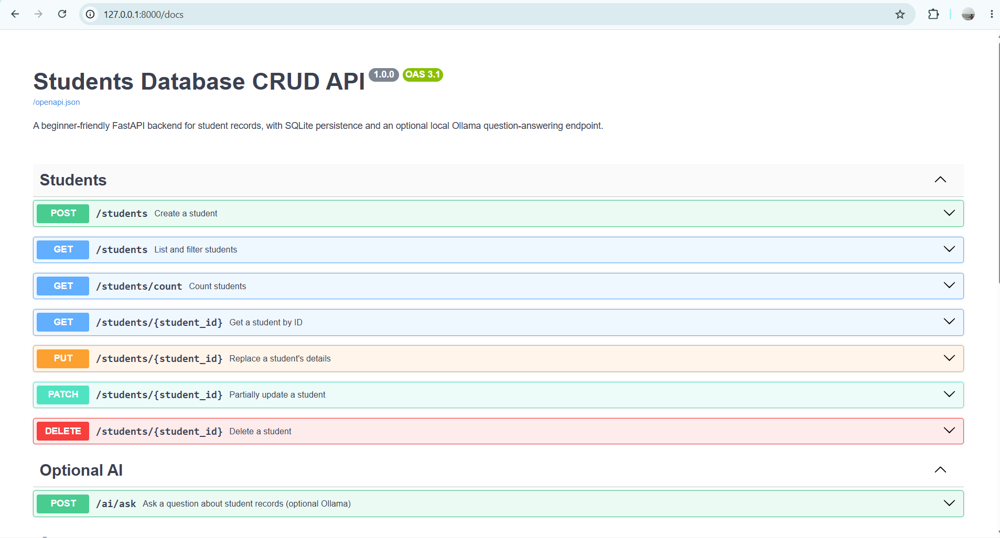
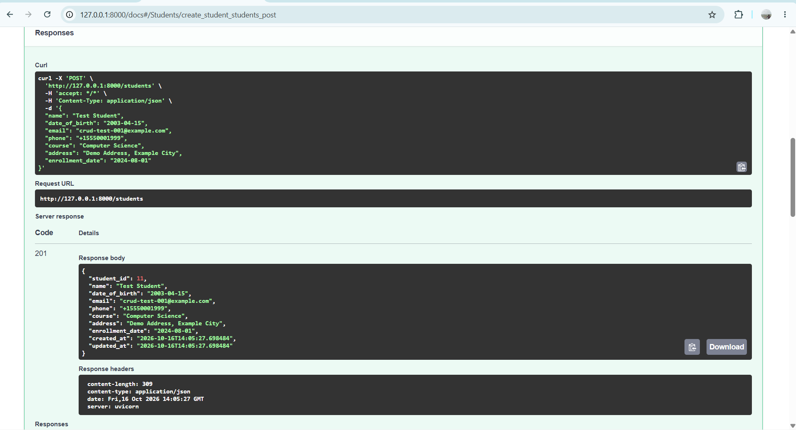
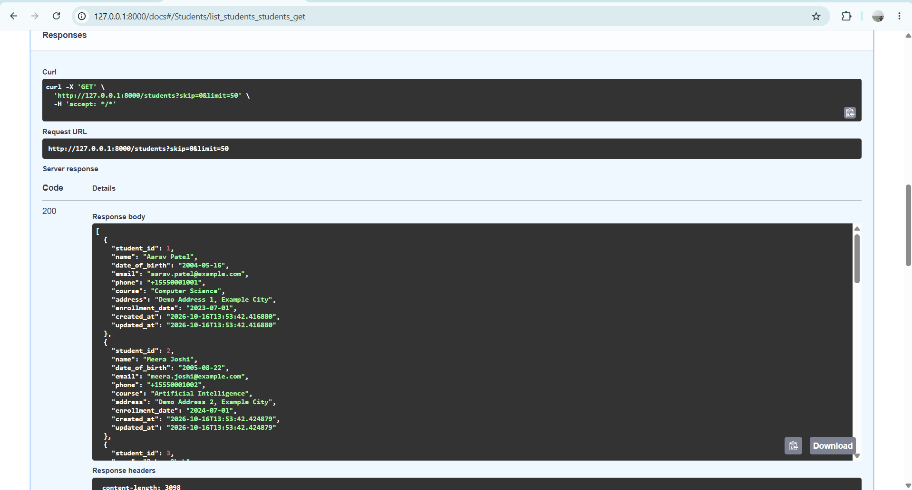
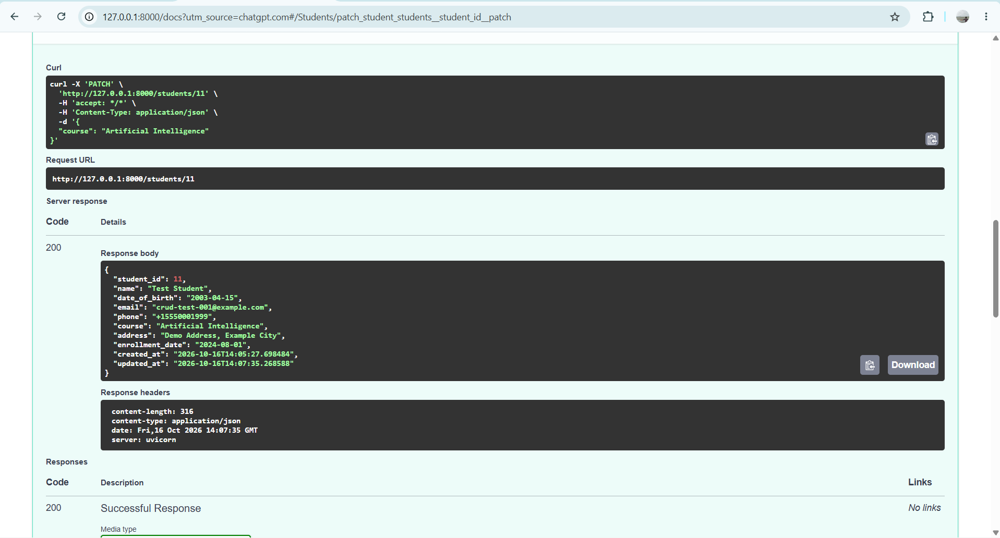
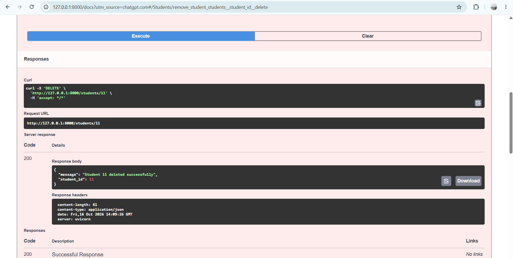
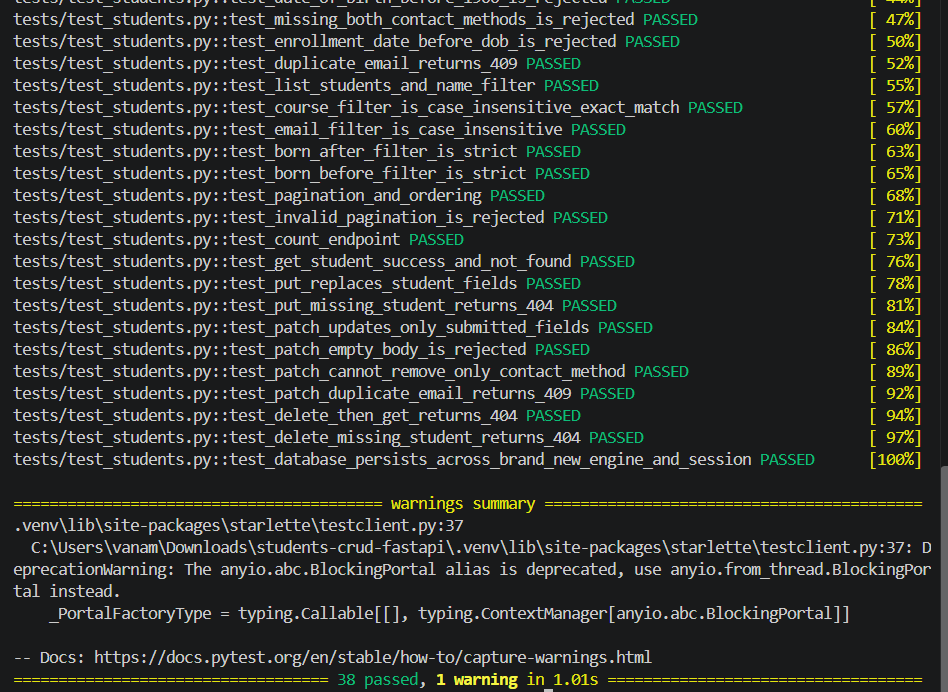
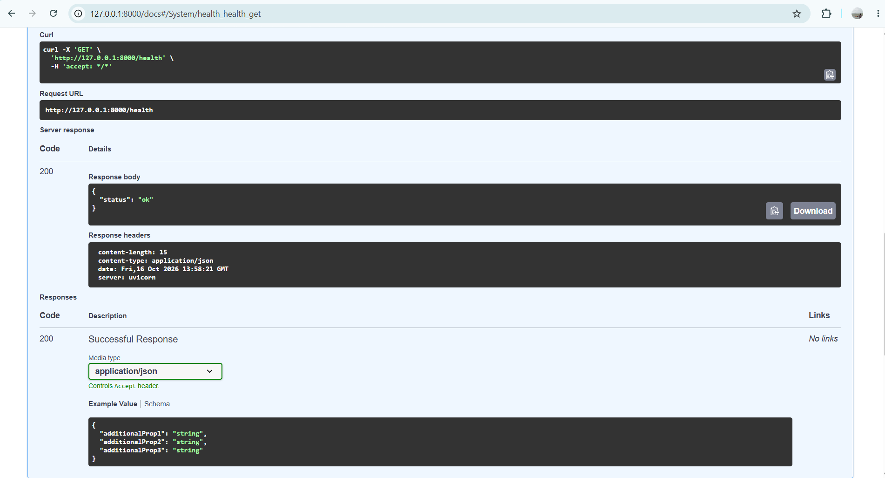
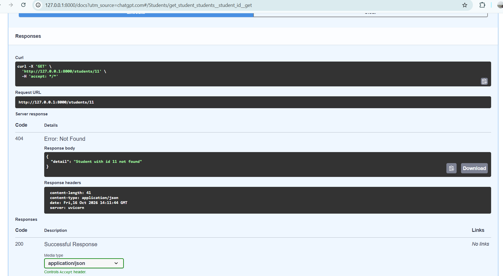

# Students Database CRUD API

A Python backend application for managing student records through a REST API. Built with **FastAPI**, **SQLAlchemy 2.x**, and **SQLite**, this project provides complete Create, Read, Update, and Delete (CRUD) functionality, request validation, filtering, pagination, automated tests, and an optional local AI question-answering extension powered by Ollama.


## Table of contents

- [Overview](#overview)
- [Features](#features)
- [Technology stack](#technology-stack)
- [Project structure](#project-structure)
- [Getting started](#getting-started)
- [Configuration](#configuration)
- [Run the application](#run-the-application)
- [API reference](#api-reference)
- [Request examples](#request-examples)
- [Validation and error handling](#validation-and-error-handling)
- [Run the tests](#run-the-tests)
- [Optional AI extension with Ollama](#optional-ai-extension-with-ollama)
- [Architecture and security](#architecture-and-security)
- [Screenshots](#screenshots)
- [License](#license)

## Overview

The application stores student records in a local SQLite database and exposes documented HTTP endpoints for creating and managing those records. FastAPI generates interactive documentation automatically, so endpoints can be demonstrated from a browser without a separate frontend.

The core CRUD application does **not** require an AI model or an API key. An optional Ollama extension can answer supported natural-language questions using records retrieved safely by the backend.

## Features

- Create student records with an automatically generated unique ID.
- List, filter, and paginate student records.
- Retrieve a single student by ID.
- Replace a student's editable fields with `PUT` or update selected fields with `PATCH`.
- Delete student records and return a confirmation response.
- Persist data locally using SQLite.
- Validate names, dates of birth, email addresses, phone numbers, and enrollment dates.
- Normalize email addresses and phone numbers; reject duplicate email addresses.
- Return appropriate HTTP status codes and clear error messages.
- Explore and test endpoints with Swagger UI and ReDoc.
- Run an automated test suite using `pytest` and `httpx`.
- Optionally ask questions about student data using a local Ollama model, with deterministic fallback answers when Ollama is unavailable.

## Technology stack

| Technology | Purpose |
|---|---|
| Python 3.10+ | Application language |
| FastAPI | REST API framework and automatic OpenAPI documentation |
| Uvicorn | ASGI development server |
| SQLAlchemy 2.x | ORM and database access |
| SQLite | Persistent local database |
| Pydantic v2 | Request validation and response schemas |
| Pytest + HTTPX | Automated API testing |
| Ollama (optional) | Local language model for natural-language questions |

Dependency versions are pinned in `requirements.txt` for reproducible setup.

## Project structure

```text
students-crud-fastapi/
├── app/
│   ├── __init__.py
│   ├── main.py                 # FastAPI app and startup configuration
│   ├── config.py               # Environment-based configuration
│   ├── database.py             # SQLAlchemy engine and DB session dependency
│   ├── models.py               # SQLAlchemy Student model
│   ├── schemas.py              # Pydantic request/response schemas
│   ├── crud.py                 # Database operations
│   ├── routers/
│   │   ├── __init__.py
│   │   └── students.py         # Student HTTP endpoints
│   └── ai/                     # Optional Ollama extension
│       ├── __init__.py
│       ├── intents.py
│       ├── ollama_client.py
│       ├── service.py
│       └── router.py
├── scripts/
│   ├── __init__.py
│   └── seed.py                 # Idempotent fictional sample-data loader
├── tests/
│   ├── conftest.py
│   ├── test_students.py
│   └── test_ai.py
├── docs/
│   └── screenshots/
│       └── .gitkeep
├── .env.example
├── .gitignore
├── LICENSE
├── README.md
└── requirements.txt
```

## Getting started

### Prerequisites

- Python 3.10 or newer
- `pip`
- Git (for version control and submission)
- Ollama only if you want to use the optional AI extension

Confirm Python is installed:

```powershell
python --version
```

### 1. Get the project files

Open a terminal in the project root—the directory containing `requirements.txt`.

### 2. Create and activate a virtual environment

**Windows PowerShell**

```powershell
py -3 -m venv .venv
Set-ExecutionPolicy -Scope Process -ExecutionPolicy RemoteSigned
.\.venv\Scripts\Activate.ps1
```

If PowerShell activation is blocked, you can run the environment's Python directly using `\.venv\Scripts\python.exe`.

**macOS / Linux**

```bash
python3 -m venv .venv
source .venv/bin/activate
```

### 3. Install dependencies

```powershell
python -m pip install --timeout 120 --retries 10 -r requirements.txt
```

The extended timeout and retries can help on slower connections. This is a standard pip installation command and does not change the project's dependencies.

### 4. Create local configuration

**Windows PowerShell**

```powershell
if (-not (Test-Path .env)) { Copy-Item .env.example .env }
```

**macOS / Linux**

```bash
if [ ! -f .env ]; then cp .env.example .env; fi
```

The CRUD API uses safe defaults and does not require an API key. Keep `.env` local; never commit it to GitHub.

## Configuration

The application reads configuration from environment variables. The local `.env.example` documents the supported defaults.

| Variable | Default | Description |
|---|---|---|
| `DATABASE_URL` | `sqlite:///./students.db` | SQLAlchemy database URL |
| `APP_ENV` | `development` | Environment setting used by the application/tests |
| `OLLAMA_BASE_URL` | `http://localhost:11434` | Ollama server URL for the optional AI feature |
| `OLLAMA_MODEL` | `llama3.2:1b` | Ollama model name |

The local database file is created when the application initializes. Database files and `.env` are excluded from version control by `.gitignore`.

## Run the application

From the project root, with the virtual environment activated, run:

```powershell
uvicorn app.main:app --reload
```

The server should start at `http://127.0.0.1:8000`. Keep this terminal open while testing the API.

### Documentation and health check

| Resource | URL |
|---|---|
| Swagger UI | <http://127.0.0.1:8000/docs> |
| ReDoc | <http://127.0.0.1:8000/redoc> |
| Health check | <http://127.0.0.1:8000/health> |

The health endpoint should return:

```json
{
  "status": "ok"
}
```

### Load fictional sample data

Open a **second terminal** in the project root, activate the virtual environment, and run:

```powershell
python -m scripts.seed
```

The script inserts up to 10 fictional student records, including `example.com` email addresses and demo phone numbers. It is designed to be idempotent, so running it more than once does not duplicate the seeded records. Seeding is optional; you can create records yourself through the API.

## API reference

| Method | Endpoint | Description | Success response |
|---|---|---|---|
| `GET` | `/health` | Check API status | `200 OK` |
| `POST` | `/students` | Create a student | `201 Created` |
| `GET` | `/students` | List/filter students | `200 OK` |
| `GET` | `/students/count` | Count student records | `200 OK` |
| `GET` | `/students/{student_id}` | Retrieve one student | `200 OK` |
| `PUT` | `/students/{student_id}` | Replace a student's editable details | `200 OK` |
| `PATCH` | `/students/{student_id}` | Update selected fields | `200 OK` |
| `DELETE` | `/students/{student_id}` | Delete a student | `200 OK` |
| `POST` | `/ai/ask` | Ask a supported natural-language question (optional AI extension) | `200 OK` |

### Student fields

- `student_id`: unique integer ID generated by the database.
- `name`: required; trimmed; 2–100 characters.
- `date_of_birth`: required date in `YYYY-MM-DD` format; cannot be in the future or before `1900-01-01`.
- `email`: optional valid email; stored in lowercase and must be unique.
- `phone`: optional phone number with 10–15 digits, optionally beginning with `+`; spaces and hyphens are stripped from input.
- **Contact rule:** at least one of `email` or `phone` must be supplied.
- `course`: optional; maximum 100 characters.
- `address`: optional; maximum 255 characters.
- `enrollment_date`: optional date; cannot be earlier than date of birth.
- `created_at`, `updated_at`: timestamps maintained by the backend.

### List filters and pagination

`GET /students` supports these query parameters:

| Parameter | Description |
|---|---|
| `name` | Case-insensitive substring match |
| `course` | Case-insensitive exact match |
| `email` | Case-insensitive exact match |
| `born_after` | Return students born strictly after this date |
| `born_before` | Return students born strictly before this date |
| `skip` | Number of records to skip; default `0`; minimum `0` |
| `limit` | Maximum number of records; default `50`; range `1`–`200` |

Results are ordered by `student_id` in ascending order.

## Request examples

The following examples use fictional data. Run the API first. Use the student ID returned by `POST /students` in subsequent requests.

### Create a student

```bash
curl -X POST "http://127.0.0.1:8000/students" \
  -H "Content-Type: application/json" \
  -d '{"name":"Aarav Patel","date_of_birth":"2004-05-16","email":"aarav@example.com","phone":"+15550001111","course":"Computer Science","address":"Demo Road, Example City","enrollment_date":"2024-07-01"}'
```

Expected status: `201 Created`, with the saved student object and generated `student_id`.

### List and filter students

```bash
curl "http://127.0.0.1:8000/students"
curl "http://127.0.0.1:8000/students?name=aar&limit=10"
curl "http://127.0.0.1:8000/students?course=Computer%20Science&skip=0&limit=20"
curl "http://127.0.0.1:8000/students?born_after=2005-12-31"
curl "http://127.0.0.1:8000/students/count"
```

### Retrieve a student

Replace `1` with the ID returned by the create request:

```bash
curl "http://127.0.0.1:8000/students/1"
```

### Replace a student with `PUT`

`PUT` sends the complete replacement record, including the required fields:

```bash
curl -X PUT "http://127.0.0.1:8000/students/1" \
  -H "Content-Type: application/json" \
  -d '{"name":"Aarav Patel","date_of_birth":"2004-05-16","email":"aarav.updated@example.com","phone":"+15550001111","course":"Data Science","address":"Demo Road, Example City","enrollment_date":"2024-07-01"}'
```

### Update selected fields with `PATCH`

```bash
curl -X PATCH "http://127.0.0.1:8000/students/1" \
  -H "Content-Type: application/json" \
  -d '{"course":"Artificial Intelligence"}'
```

`PATCH` requires at least one field and validates the resulting record, including the rule that a student must have an email address or phone number.

### Delete a student

```bash
curl -X DELETE "http://127.0.0.1:8000/students/1"
```

Expected response:

```json
{
  "message": "Student 1 deleted successfully",
  "student_id": 1
}
```

Retrieving the same ID after deletion should return `404 Not Found`.

## Validation and error handling

| Status code | Meaning |
|---|---|
| `200 OK` | Read, update, or delete request completed successfully |
| `201 Created` | Student record created |
| `404 Not Found` | Requested student ID does not exist |
| `409 Conflict` | Email address already exists |
| `422 Unprocessable Entity` | Request body or query parameters failed validation |

Error responses use a JSON `detail` field. Examples include an invalid email, a missing contact method, a duplicate email, a future date of birth, or an attempt to update a nonexistent student.

## Run the tests

Run tests from the project root using the Python interpreter from the active virtual environment:

```powershell
python -m pytest -v
```

The suite uses temporary test databases and does not alter the regular `students.db`. Ollama calls are mocked in tests, so the tests do not require Ollama to be installed or running.

Coverage includes:

- Student creation and input normalization
- Invalid names, email addresses, phone numbers, dates, and missing contact details
- Duplicate-email conflict handling
- Listing, all filters, ordering, and pagination
- Count, retrieve, update, and delete operations
- Missing-record responses and empty PATCH requests
- SQLite persistence across a new engine/session
- AI intent parsing, record-grounded answers, and fallback behavior

## Optional AI extension with Ollama

The AI endpoint is optional. The CRUD API works without Ollama.

1. Install Ollama from <https://ollama.com/>.
2. Download the model configured by default:

   ```bash
   ollama pull llama3.2:1b
   ```

3. Make sure the Ollama server is running. If it does not start automatically, run this command in a separate terminal:

   ```bash
   ollama serve
   ```

4. With FastAPI still running, send a question to the AI endpoint:

   ```bash
   curl -X POST "http://127.0.0.1:8000/ai/ask" \
     -H "Content-Type: application/json" \
     -d '{"question":"How many students are there?"}'
   ```

Other supported examples include:

```json
{"question":"List students born after 2005"}
{"question":"List students in Computer Science"}
{"question":"Show student ID 1"}
{"question":"Show student ID 1 and their email"}
```

The response includes `question`, `intent`, `answer`, `records_used`, `model`, and `ollama_available`. If Ollama is unreachable or times out, the service logs a warning and returns a deterministic answer based on the same database records.

### AI safety measures

- The backend recognizes a fixed allow-list of supported intents: `count_students`, `list_students`, `get_student`, and `students_in_course`.
- Database records are retrieved by the backend through SQLAlchemy ORM queries; the language model never writes or executes SQL.
- At most 50 records are passed to the model for a request.
- Email, phone, and address are omitted from model context unless the question requires contact details.
- The model is instructed to answer only from the supplied records and ignore instructions embedded in record content.
- Use fictional data for demonstrations; do not publish real student personal information.

**Date interpretation:** For the AI question “born after 2005,” the implementation uses `2006-01-01` as the inclusive lower bound for date-only birthdays.

## Architecture and security

The project separates HTTP handling, validation, and database operations:

- **`app/main.py`** creates the FastAPI application, includes routers, and initializes the database tables.
- **`app/database.py`** creates the SQLAlchemy engine and provides the database-session dependency.
- **`app/models.py`** defines the database model.
- **`app/schemas.py`** validates input data and defines response models.
- **`app/crud.py`** contains database operations, separate from HTTP response handling.
- **`app/routers/students.py`** defines the student API endpoints.
- **`app/ai/`** contains the optional intent detection, Ollama client, service logic, and API route.
- **`tests/`** verifies expected behavior with isolated databases and mocked AI calls.

Secrets and local runtime data are excluded through `.gitignore`. Use dummy records only for demonstrations and screenshots.

## Screenshots

The following screenshots demonstrate the API documentation, student CRUD operations, health check, and automated test results. All student records shown are fictional demo data.

### API documentation



### Create a student — `POST /students`



### List students — `GET /students`



### Update a student — `PATCH /students/{student_id}`



### Delete a student — `DELETE /students/{student_id}`



### Automated tests



### Health check — `GET /health`



### Deleted student not found — `GET /students/11`



These screenshots are stored in `docs/screenshots/`. Review them before committing to ensure they do not contain secrets or real student information.

## License

This project is licensed under the MIT License. See [`LICENSE`](LICENSE) for details.
